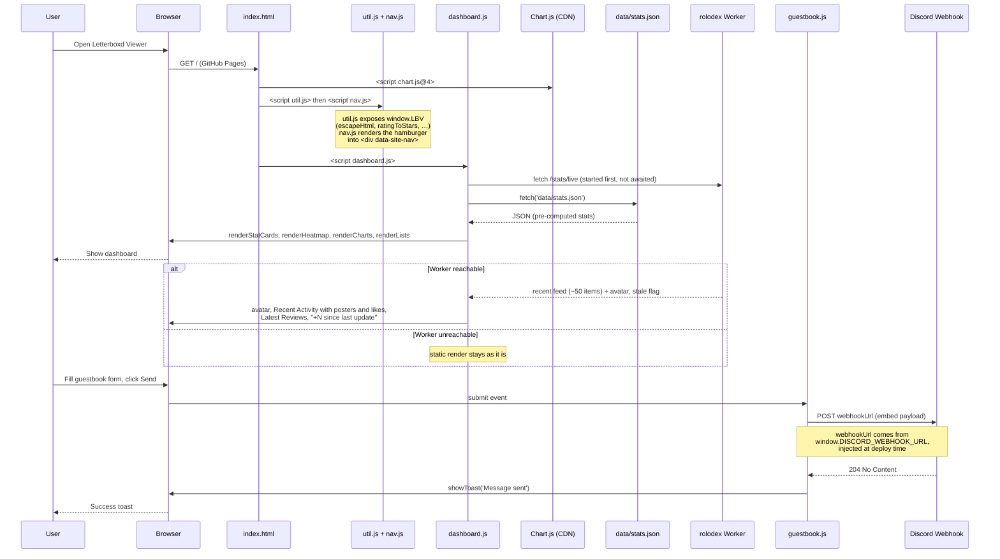
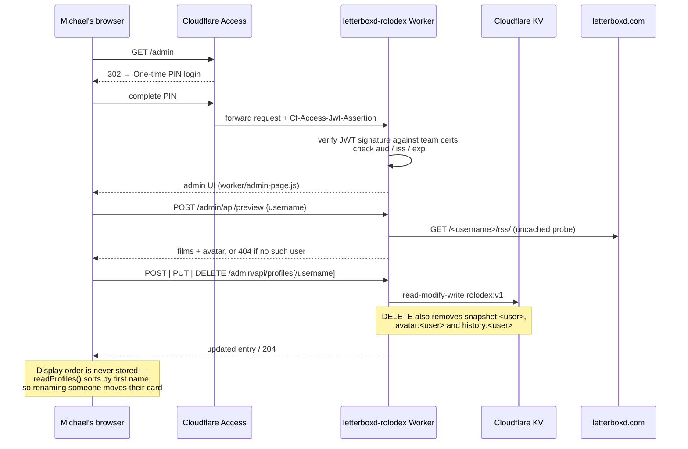
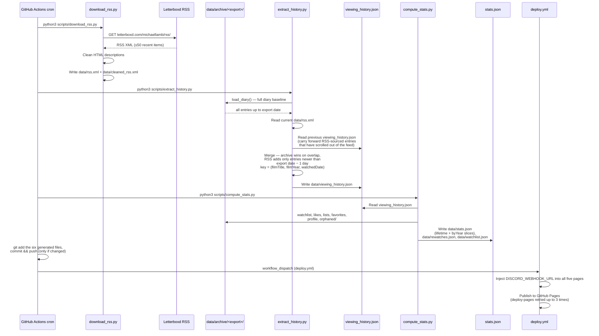

# Letterboxd Viewer Sequence Diagrams

How the stats dashboard and the rolodex load, how the rolodex Worker enriches
profiles, how the admin curates them, and how the cron pipeline refreshes the
stats data. The other three pages (Network, Tags, Rewatches) are plain static
consumers of a JSON file under `data/` and have no diagram; see CLAUDE.md.

## Runtime: stats dashboard (`index.html`)



## Runtime: rolodex (`rolodex.html`, NDJSON streaming)

Letterboxd serves RSS with **no CORS headers**, so friends' feeds can never be
fetched browser-side — everything goes through the Worker at
`rolodex.michaellamb.dev`. The page loads over a stream: cards render from the
curated list before a single feed has resolved, then fill in as profile lines
arrive in **completion order**.

```mermaid
sequenceDiagram
    participant User
    participant Rolodex as rolodex.js
    participant Worker as letterboxd-rolodex Worker
    participant KV as Cloudflare KV

    User->>Rolodex: Open /rolodex
    Rolodex->>Rolodex: renderPlaceholders()
    Rolodex->>Worker: GET /rolodex/stream
    Worker->>KV: get rolodex:v1 (one read)
    KV-->>Worker: curated list (sorted by first name on read)
    Worker-->>Rolodex: line 1: {"type":"meta", profiles:[…]}
    Rolodex->>Rolodex: draw ALL card shells<br/>(name, note, tags, data-search, data-letter)
    Note over Rolodex: Filter box + A-Z rail are live now —<br/>they only read meta-line data,<br/>so they never race the fill

    loop per profile, ≤6 concurrent, completion order
        Worker->>Worker: enrich(profile)  — see next diagram
        Worker-->>Rolodex: {"type":"profile", username, films, avatar, stale, history}
        Rolodex->>Rolodex: fillCard(matched by username)
    end
    Worker-->>Rolodex: stream closes
    Rolodex->>Rolodex: settlePending()<br/>(anything unresolved → empty, stale)

    alt stream unsupported or fails
        Rolodex->>Worker: GET /rolodex (whole payload)
        Worker-->>Rolodex: JSON, all profiles at once
    end

    %% Navigation
    User->>Rolodex: pick a sort
    Rolodex->>Rolodex: applySort(): re-append the card nodes;<br/>film-based sorts re-apply once at stream end
    User->>Rolodex: type in filter / click a letter
    Rolodex->>Rolodex: applyFilter(): hide non-matching cards,<br/>disable letters with no visible card
    Rolodex->>Rolodex: jumpToLetter(): instant scrollIntoView
```

## Worker: enriching one profile

Per-profile caching is what shields letterboxd.com — each feed is fetched at
most once per 15 minutes no matter how many visitors arrive. Snapshots make a
failing feed degrade to "last known good, flagged stale" instead of a blank card.
On a cache miss the whole feed is also merged into `history:<username>`, which
is what the history sorts and the card's "N logged" line read. A Worker cron
(`0 */3 * * *`) runs this same path for 1/8 of the rolodex per run, so every
member's feed is read daily.

```mermaid
sequenceDiagram
    participant Worker as enrichmentFor(profile)
    participant Cache as caches.default (15min TTL)
    participant KV as Cloudflare KV
    participant LB as letterboxd.com

    par films
        Worker->>Cache: match rss/<username>
        alt cache hit
            Cache-->>Worker: parsed last-four payload
        else miss
            Worker->>LB: GET /<username>/rss/
            alt 200 OK
                LB-->>Worker: RSS XML
                Worker->>Worker: parseFeed(): keep only items with<br/>letterboxd:watchedDate (skip lists),<br/>decode entities; first 4 go on the card
                Worker->>KV: mergeHistory() into history:<username><br/>(written only when something changed)
                Worker->>Cache: put (15min)
                Worker->>KV: put snapshot:<username> (no TTL)
            else error / non-200
                Worker->>KV: get snapshot:<username>
                KV-->>Worker: last known-good four → stale: true
            end
        end
    and avatar
        Worker->>KV: get avatar:<username>
        alt miss
            Worker->>LB: GET /<username>/ (profile page)
            Worker->>Worker: HTMLRewriter: og:image content
            Worker->>KV: put avatar:<username> (24h TTL)
        end
    end
```

## Admin: curating the rolodex (`/admin`, Cloudflare Access)

The hostname is mixed: `GET /rolodex*` is public, only `/admin*` sits behind
Access (path-scoped app, One-time PIN). The Worker also verifies the Access JWT
itself, so a missing or misconfigured Access app fails closed.



This shows the Profiles tab only. The admin also has Feed health, Backup &
bulk, Rolodex tags, Pipeline and Diary tags tabs; the last two read and write
this repo through the GitHub API. CLAUDE.md (**Rolodex → Admin**) covers them.

## Data pipeline (cron, every 6 hours)

Feeds the dashboard, Tags (`viewing_history.json`) and Rewatches
(`rewatches.json`). The rolodex cards do not touch this pipeline; they are
entirely Worker + KV. (The admin's Pipeline tab can dispatch this workflow and
commit a watchlist CSV.)



## Key ideas

- **Archive + RSS merge.** Letterboxd's RSS only exposes the ~50 most recent
  diary entries. The full history comes from a Letterboxd export archive under
  `data/archive/`; RSS layers on only entries logged **after** the export date.
  The archive wins on overlap, which also lets its deletions stick. RSS-sourced
  entries are carried forward from the previous `viewing_history.json`, since
  the feed is a sliding window. (An earlier
  design reconstructed history by walking every git commit of `data/rss.xml`;
  the archive replaced that.)
- **Two data planes.** The stats dashboard is static — pre-computed JSON,
  refreshed by the GitHub Actions cron — with an optional live layer from the
  Worker's `/stats/live` that it never depends on. The rolodex is fully live —
  Worker + KV, with its own Worker cron keeping histories current. They share
  the static shell (CSS, `util.js`, `nav.js`, `guestbook.js`).
- **Streaming beats caching harder.** All per-profile cache entries are filled
  by whichever request finds them empty, so they expire together ~15min later.
  Rather than making the unlucky cold visitor wait on the slowest of 60+ feeds,
  the stream gives them every card instantly and fills posters as feeds resolve.
